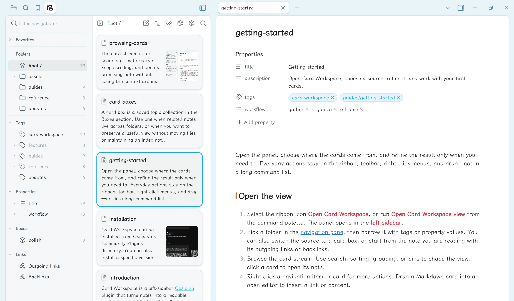
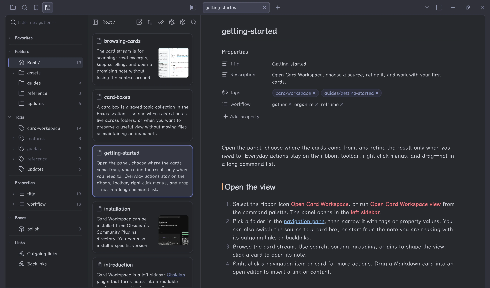

Card Workspace has its own two-column pane: a navigation column next to the card stream. You do not need Obsidian’s File Explorer to move between structure, metadata, saved views, and note connections.

## Sections

The default order is:

1. **Favorites**
2. **Folders**
3. **Tags**
4. **Properties**
5. **Boxes**
6. **Links**

Right-click a section header and choose **Move section up** or **Move section down** to change the order. Each section remembers its collapsed state separately.

<figure class="cw-doc-shot" id="screenshot-navigation-overview">

<figcaption>The navigation column brings folders, tags, properties, boxes, and links together beside the card stream. The vault root is selected here.</figcaption>
</figure>

## Filter navigation

Type in **Filter navigation…** to match favorites, folders, tags, enabled property keys and values, card boxes, and the Outgoing links or Backlinks entries. Chinese names work. Nested matches keep their ancestors visible. Press Escape or use the clear button to empty the filter.

## Resize and collapse

Drag the divider to resize the navigation column (default 240, minimum 160, maximum 480). With the divider focused, arrow keys change the width by 8 pixels (Shift: 32); Home and End jump to the limits.

The header action **Collapse navigation** gives the cards the full panel width. The two-column layout stays available while the card column has at least 160 CSS pixels. Below that, the layout becomes a single pane and the same action swaps between navigation and cards.

## Folders and tags

Click a folder to browse its cards. Folder scope includes subfolders by default; change that from the **Folders** header or its right-click menu. Right-click **Search in folder** to select the folder and focus the in-panel search described in [Browsing cards](./browsing-cards.md).

Click a tag to filter the folder stream. Ctrl-click on Windows/Linux or Cmd-click on macOS adds or removes a tag; several tags use AND matching. Parent tags include their descendants. Tag menus can also create a note with that tag, rename it across references, or delete it after confirmation. Activating a tag filter clears property filters, and activating a property filter clears tag filters.

From the **Folders** header, choose **Reveal active note's folder** to expand and select the folder that contains the note open in the editor. If navigation visibility is hiding that folder, restore it in settings first.

## Hide navigation entries

Right-click a folder, tag, or section header and choose **Hide this folder**, **Hide this tag**, or **Hide this section**. Hiding a parent also hides its children. The rules are shared by every Card Workspace view, saved across restarts, and follow folder moves, folder renames, and tag renames made in the plugin.

Hidden entries leave the navigation column only. Cards in the current source, search, filters, and favorites you already saved stay available. If every section is hidden, the column asks you to restore them in settings.

Open **Settings → Card Workspace → Navigation** to show a section again, or choose **Manage** under **Hidden folders** or **Hidden tags**. That list can search the whole vault, hide or restore matches, and restore everything. A child hidden by its parent asks you to restore the parent first. See [Navigation visibility](../reference/settings.md#navigation-visibility).

## Arrange folders, tags, and properties

In **Folders**, drop on the middle of a row to move the dragged folder into it. Drop on the top or bottom quarter to place it before or after that sibling. The vault root stays first and only accepts moves into it. Hovering a collapsed row for about 600 ms expands it; dragging near the top or bottom edge scrolls the list. A name conflict is rejected, and the existing folder is left as it is.

Each sibling group remembers its own order. The first successful reorder switches that group to **Manual sorting**, and new folders then append to the group. The Folders header and the vault-root row sort top-level folders. Any other folder’s menu sorts its direct children. The choices are:

- **Sort child folders by name (A → Z)** — clears the saved manual order
- **Sort child folders by name (Z → A)** — keeps descending name order, with new folders appended
- **Manual sorting** — keeps the current order

The active choice is checked. Folder dragging stays inside Folders; favorite dragging stays inside Favorites.

Right-click the **Tags** or **Properties** header to sort that section by **Name (A to Z)**, **Name (Z to A)**, or **Manual sorting**. A parent tag’s menu sorts its direct subtags, and a property name’s menu sorts its values. Drop a sibling on the upper or lower half of a row to place it before or after that row; the drop selects manual order. Dragging changes display order only. New items join a name sort as they appear and append to a manual list. **Unassigned** stays last and cannot be dragged. A tag rename made in the plugin carries the saved order to the new name.

## Properties and links

The **Properties** section is empty until you choose the frontmatter keys worth keeping visible. While a folder source is open, expanding a key reveals its values and lets you filter the stream. Tag and property rows are unavailable in card-box and linked-note sources; existing folder filters stay dormant there and resume when you return to a folder. See [Property filters](./property-filters.md).

The **Links** section has two fixed entries: **Outgoing links** and **Backlinks**. They follow the active note unless you pin the source. See [Linked notes](./linked-notes.md).

## Favorites and boxes

You can favorite a folder, file, tag, or card box. Favorites share one list across all kinds and can be reordered across kinds by dragging or with their menus. New favorites append to the list, and manual order persists across restarts. A file favorite opens the note without replacing the current card source.

[Card boxes](./card-boxes.md) are reusable topic collections with their own rules and arrangement. Opening one replaces the current source until you choose another folder, box, or linked-note direction.

## Counts and keyboard navigation

Navigation counts are off by default. Enable **Show item counts in navigation** in [Settings](../reference/settings.md). Hover tooltips still describe folder and tag counts when badges are hidden; active tag and property-filter summaries remain visible.

In the navigation tree, use arrow keys, Home, and End to move focus; Left and Right collapse or expand; Enter activates; Space additively toggles a tag or property value; Shift+F10 or the Menu key opens the context menu.
