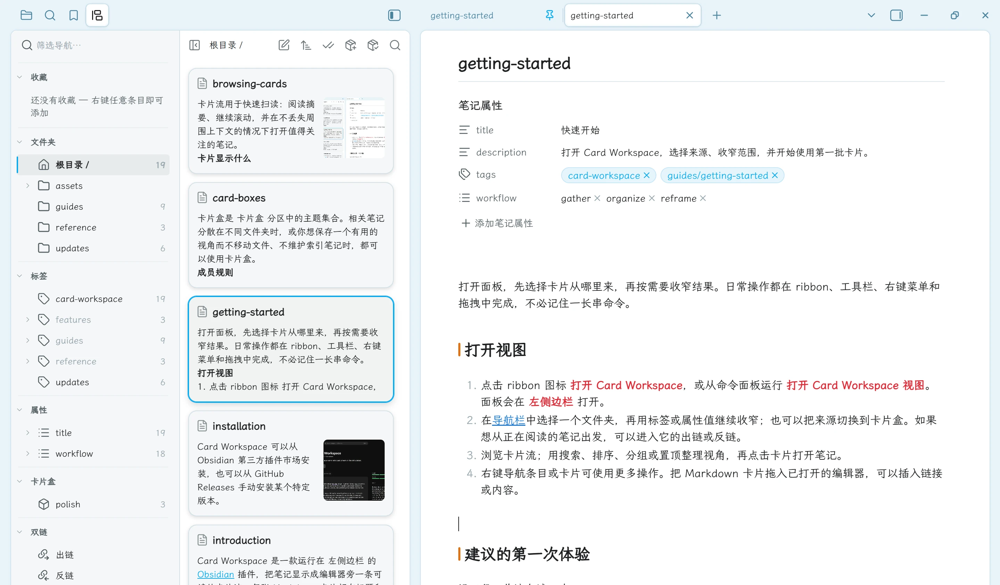
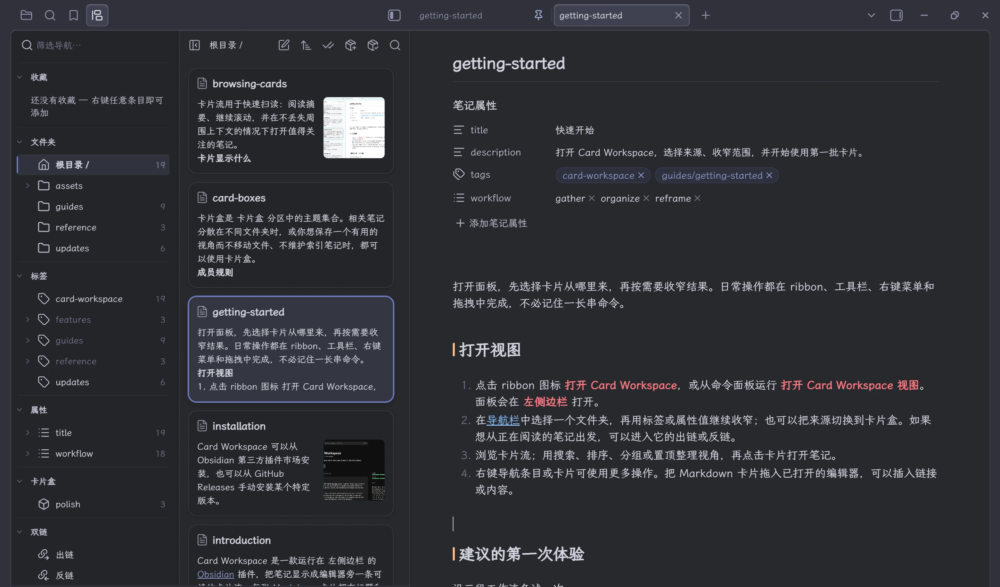

打开面板，先选择卡片从哪里来，再按需要收窄结果。日常操作都在 ribbon、工具栏、右键菜单和拖拽中完成，不必记住一长串命令。

## 打开视图

1. 点击 ribbon 图标 **打开 Card Workspace**，或从命令面板运行 **打开 Card Workspace 视图**。桌面端面板会在 **左侧边栏** 打开；手机和平板上则作为页面在主工作区打开。
2. 记下想法：点击工具栏的 **新建**，从 **模板** 中选择模板，或点击纸飞机按钮（**打开快速输入**）。详见[快速输入与模板](./quick-input-and-templates.md)。
3. 在[导航栏](./navigation.md)中选择一个文件夹或卡片盒，再用标签或属性值继续收窄。如果想从正在阅读的笔记出发，可以进入它的出链或反链。
4. 浏览卡片流；用搜索、排序、分组或置顶整理视角，再点击卡片打开笔记。
5. 右键导航条目或卡片可使用更多操作。把 Markdown 卡片拖入已打开的编辑器，可以插入链接或内容；把卡片拖到文件夹、标签、属性值或卡片盒上，可以直接整理笔记。在移动端改用菜单按钮，详见[手机与平板](./mobile.md)。

<figure class="cw-doc-shot" id="screenshot-workspace-overview">

<figcaption>Card Workspace 位于编辑器旁：选择文件夹、浏览卡片，点击卡片即可打开笔记并保留卡片流。</figcaption>
</figure>

## 建议的第一次体验

沿四段工作流各试一次：

- **输入：** 打开快速输入，写一行文字并添加一个标签，按 Ctrl/Cmd+Enter 发送。
- **汇集：** 打开一个项目文件夹，在[属性筛选](./property-filters.md)中启用 `workflow` 并选择一个值。
- **整理：** 打开 **排序与分组**，再把当前文件夹视角保存为[卡片盒](./card-boxes.md)。
- **重构：** 打开一篇笔记，对比它的[出链和反链](./linked-notes.md)。

这套文档本身包含少量标签、属性和 Markdown 链接，因此也可以作为 Obsidian 中的演示笔记库。

## 再次启动

Card Workspace 会恢复上次浏览的 **文件夹**；如果是库根目录，则恢复整个仓库。它不会重新打开上次的卡片盒或双链来源。

想了解卡片流的细节，可以继续阅读[浏览卡片](./browsing-cards.md)或[写作与整理](./writing-and-organizing.md)。
