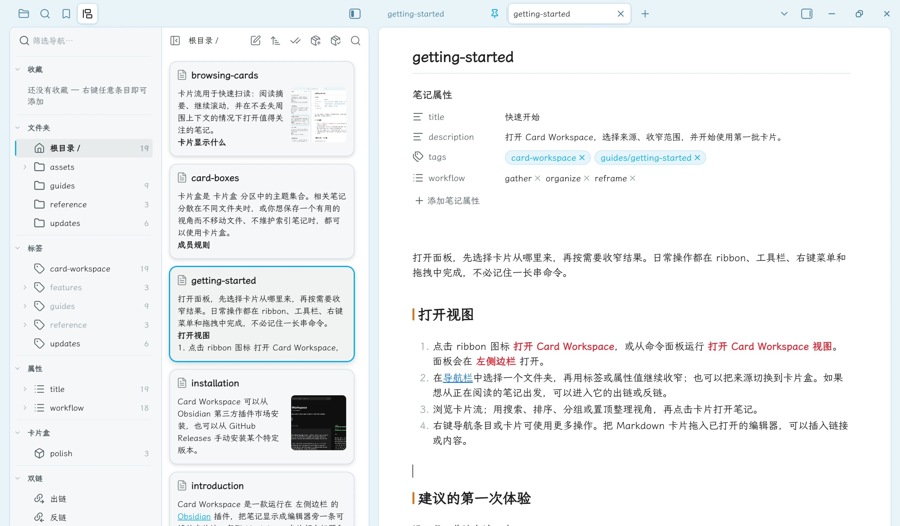

Card Workspace 有自己的双栏面板：导航列紧挨着卡片流。你不必借用 Obsidian 文件浏览器，就能在仓库结构、元数据、保存的视角和笔记连接之间移动。

## 分区

默认顺序为：

1. **收藏**
2. **文件夹**
3. **标签**
4. **属性**
5. **卡片盒**
6. **双链**

右键分区标题，选择 **分区上移** 或 **分区下移** 即可调整顺序。每个分区会单独记住折叠状态。

<figure class="cw-doc-shot" id="screenshot-navigation-overview">

<figcaption>导航列集中显示文件夹、标签、属性、卡片盒和双链入口，右侧紧邻卡片流。图中选中的是库根目录。</figcaption>
</figure>

## 筛选导航

在 **筛选导航…** 中输入内容，可以匹配收藏、文件夹、标签、已启用的属性名和值、卡片盒，以及出链和反链入口。中文名称也能匹配；嵌套条目命中时会保留祖先节点。按 Escape 或清除按钮可以清空筛选。

## 调整宽度与折叠

拖动分隔条可调整导航列宽度（默认 240，最小 160，最大 480）。分隔条获得焦点后，方向键每次调整 8 像素（Shift：32）；Home 和 End 跳到最小或最大宽度。

标题栏中的 **折叠导航栏** 会让卡片占满面板。卡片列至少有 160 CSS 像素时保持双栏；再窄就会改成单栏，同一个操作用于在导航与卡片之间切换。

## 文件夹与标签

点击文件夹即可浏览其中的卡片。默认包含子文件夹，可从 **文件夹** 标题或右键菜单切换。右键 **在文件夹中查找** 会选中该文件夹，并聚焦[浏览卡片](./browsing-cards.md)中介绍的面板内搜索。

点击标签会筛选文件夹卡片流。Ctrl（Windows/Linux）或 Cmd（macOS）加点击可以追加或移除标签；多个标签之间为 AND。父标签会包含其子标签。标签菜单还可以新建带标签的笔记、同步重命名引用，或确认后删除标签。启用标签筛选会清除属性筛选；切换到属性值筛选时也会清除标签筛选。

在 **文件夹** 标题上选择 **定位当前笔记所在文件夹**，即可展开并选中编辑器中当前笔记所在的文件夹。如果导航可见性隐藏了该文件夹，需要先在设置中恢复。

## 隐藏导航条目

右键文件夹、标签或分区标题，选择 **隐藏此文件夹**、**隐藏此标签** 或 **隐藏此分区**。隐藏父项时，其子项也会隐藏。这些规则在所有 Card Workspace 视图之间共享，重启后仍然保留，并会跟随文件夹移动、文件夹重命名，以及在插件内进行的标签重命名。

隐藏只影响导航列。当前来源中的卡片、搜索、筛选，以及已经保存的收藏仍然可用。所有分区都被隐藏时，导航列会提示到设置中恢复。

打开 **设置 → Card Workspace → 导航** 可以重新显示某个分区，或在 **隐藏的文件夹**、**隐藏的标签** 下点击 **管理**。列表可以搜索全库、隐藏或恢复匹配项，也可以全部恢复。被子项的父项隐藏时，需要先恢复父项。详见[导航可见性](../reference/settings.md#导航可见性)。

## 排列文件夹、标签和属性

在 **文件夹** 中，拖到一行的中部会把文件夹移入该行；拖到上四分之一或下四分之一会把它放到该同级项之前或之后。库根目录始终排在最前，并且只接受移入。在折叠的行上停留约 600 毫秒会展开它；拖到列表上沿或下沿附近会滚动。名称冲突会被拒绝，已有文件夹保持原样。

每一组同级文件夹各自记住顺序。第一次成功的拖拽排序会把该组切换为 **手动排序**，之后新建的文件夹追加到组末尾。文件夹标题和库根目录一行用来排列顶层文件夹；其他文件夹的菜单排列它的直接子文件夹。可选项为：

- **子文件夹按名称排序（A → Z）** — 清除已保存的手动顺序
- **子文件夹按名称排序（Z → A）** — 保持名称降序，新建文件夹追加在后面
- **手动排序** — 保持当前顺序

当前选项会显示为已勾选。文件夹拖拽只在文件夹分区内进行；收藏拖拽只在收藏分区内进行。

右键 **标签** 或 **属性** 标题，可以按 **名称升序**、**名称降序** 或 **手动排序** 排列该分区。父标签的菜单排列其直接子标签，属性名的菜单排列它的值。把同级项拖到一行的上半部或下半部，即可放到该项之前或之后，并切换为手动顺序。拖拽只改变显示顺序。新条目会加入名称排序，或追加到手动列表末尾。**未赋值** 始终排在最后，不能拖动。在插件内重命名标签时，已保存的顺序会带到新名称上。

## 属性与双链

**属性** 分区默认为空，直到你选择值得长期显示的 frontmatter key。打开文件夹来源时，展开 key 后即可按值筛选卡片流；进入卡片盒或双链来源后，标签和属性条目不可用，已有的文件夹筛选会暂时停用，返回文件夹后恢复。详见[属性筛选](./property-filters.md)。

**双链** 分区固定包含 **出链** 和 **反链**。它们默认跟随编辑器中的活动笔记，也可以固定来源。详见[双链导航](./linked-notes.md)。

## 收藏与卡片盒

文件夹、文件、标签和卡片盒都可以收藏。收藏以一个列表混合显示不同类型，可以直接跨类型拖动排序，也可以使用右键菜单。新收藏会加入列表末尾，重启后保留手动顺序。文件收藏只会打开笔记，不会替换当前卡片来源。

[卡片盒](./card-boxes.md)是带有独立规则和排列方式的主题集合。打开一个卡片盒后，它会成为当前来源，直到你选择另一个文件夹、卡片盒或双链方向。

## 计数与键盘

导航计数默认关闭，可在[设置](../reference/settings.md)中开启 **在导航栏显示条目计数**。即使徽章隐藏，文件夹和标签的悬停提示仍会提供数量；生效中的标签与属性筛选摘要会继续显示。

在导航树中：方向键、Home、End 移动焦点；左右键展开或折叠；Enter 激活；Space 追加切换标签或属性值；Shift+F10 或菜单键打开右键菜单。
